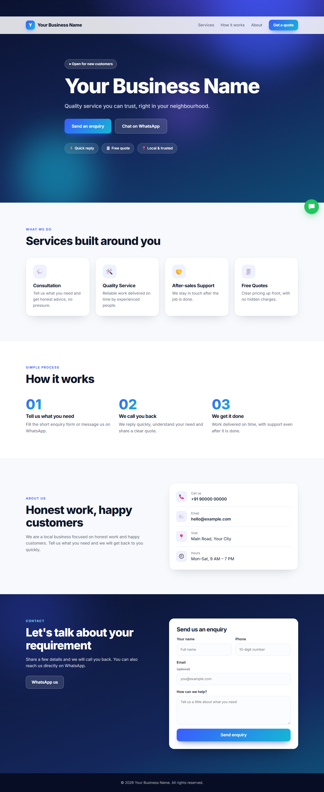
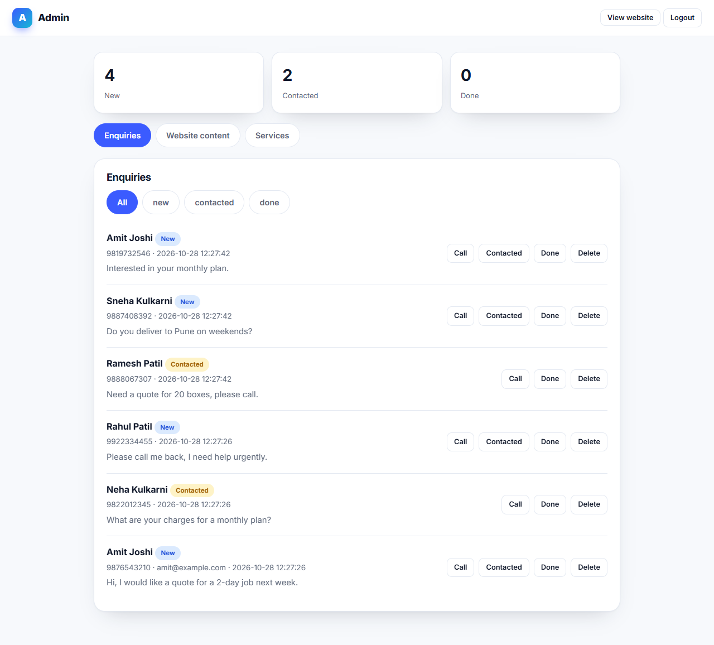
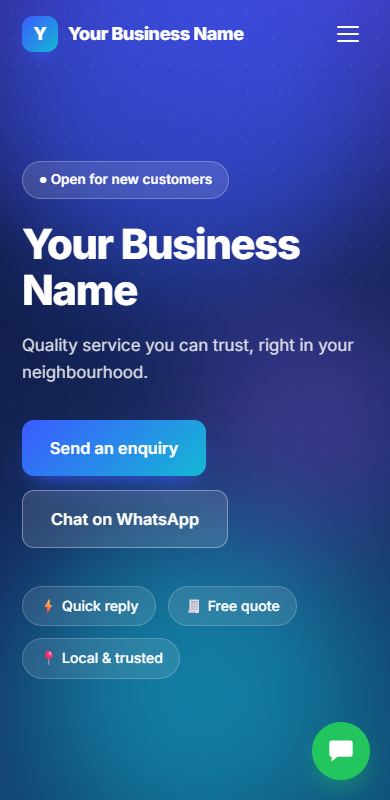

# Business Website + Enquiry Desk

**Live demo:** https://business-website-ied4.onrender.com  ·  Admin: https://business-website-ied4.onrender.com/admin (phone `9000000001`, password `123456`)

**Flutter app (web demo):** https://dapper-beijinho-ec2c42.netlify.app  ·  login `9000000001` / `123456`

> Free hosting: the first load can take ~30–60 s while the server wakes up; demo data resets on restart.

A ready-to-customise website for any local business, plus a Flutter app for the owner to manage customer enquiries.

- **web/** – React (Vite) website: animated hero, services, how it works, about, enquiry form, floating WhatsApp button, and an owner admin at `/admin` (edit content, services, enquiries).
- **backend/** – Node/Express + SQLite API (JWT auth, validation, spam guard on the public form). Also serves the built website.
- **mobile/** – Flutter (Android) app: login, live enquiry list with stats, call / WhatsApp in one tap, status updates, pull to refresh.

Demo admin login: phone `9000000001`, password `123456`.

## Screenshots

| Website | Admin: enquiries |
| --- | --- |
|  |  |

| Mobile |
| --- |
|  |

## Run locally

```bash
cd backend && npm install && npm run seed && npm start   # API on http://localhost:5002
cd web && npm install && npm run dev                     # website on http://localhost:5175
```

Open `/admin` on the website to edit the business name, text, contact details and services — no code changes needed for a new client.

Tests: `cd backend && npm test` · `cd mobile && flutter test`.

## Mobile app

```bash
cd mobile
flutter pub get
flutter run                  # emulator talks to http://10.0.2.2:5002 by default
flutter build apk --release  # build/app/outputs/flutter-apk/app-release.apk
```

On the login screen, open **Server settings** and enter your live server address (https) to point the app at a deployed backend. To change the default, edit `defaultBaseUrl` in `mobile/lib/api.dart`.

## Deploy (Render, free)

1. Push this folder to GitHub.
2. Render → New → Blueprint → select the repo (`render.yaml` is detected).
3. One service serves the website and the API.

Free-plan notes: the server sleeps when idle (first load is slow) and the SQLite file resets on restart; `AUTO_SEED=1` refills the demo data. Use a VPS or a paid plan with a disk for a real client.
